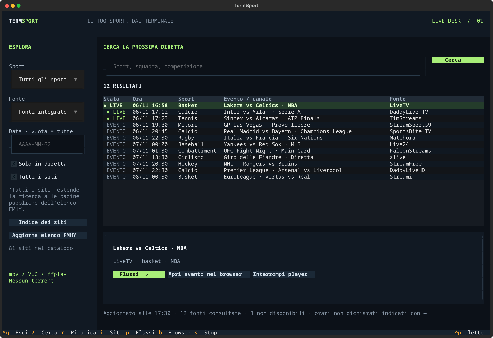

# TermSport

**TermSport 0.3.3** porta eventi sportivi e dirette in un’app TUI per Linux, macOS
e Windows. Cerca sport, squadre e competizioni, scegli una fonte e apri la diretta
dal terminale.

Interfaccia Python/Textual ispirata al flusso di lavoro di
[Torrra](https://github.com/stabldev/torrra), con codice indipendente e senza
componenti torrent, Jackett, Prowlarr o Real-Debrid.



## Installazione rapida — Linux / Ubuntu / Arch

```sh
curl -fsSL https://github.com/Emanueleparis98/termsport/releases/latest/download/install.sh | sh
termsport
```

L’installer pubblico verifica SHA-256, installa [uv](https://docs.astral.sh/uv/guides/tools/)
se manca e gestisce Python 3.13 in un ambiente isolato. Non richiede account GitHub,
`gh`, Git o permessi di amministratore. Se il comando non è riconosciuto nel
terminale già aperto, riaprilo per caricare il PATH aggiornato.

Per il video installa anche **mpv** o **VLC** con il gestore della distribuzione.

## Windows — PowerShell

```powershell
powershell -NoProfile -ExecutionPolicy Bypass -Command "irm https://github.com/Emanueleparis98/termsport/releases/latest/download/install.ps1 | iex"
termsport
```

L’opzione `ExecutionPolicy` riguarda soltanto quel processo di installazione.
VLC o mpv è necessario per i video. VLC viene riconosciuto anche nella cartella
standard `Program Files`, senza aggiungerlo manualmente al PATH.

## Windows — Scoop

Se usi [Scoop](https://scoop.sh/), aggiungi una sola volta il bucket del progetto:

```powershell
scoop bucket add termsport https://github.com/Emanueleparis98/termsport
scoop install termsport/termsport
termsport
```

Per aggiornare: `scoop update; scoop update termsport`. Il bucket è mantenuto dal
progetto; non è un pacchetto già inserito nell’indice ufficiale WinGet.

## Arch / CachyOS — pacchetto pacman

Dalla release 0.3.3 è disponibile anche il pacchetto nativo, costruito e verificato
in un ambiente Arch con le dipendenze dei repository ufficiali:

```sh
curl -fLO https://github.com/Emanueleparis98/termsport/releases/download/v0.3.3/termsport-0.3.3-1-any.pkg.tar.zst
sudo pacman -U ./termsport-0.3.3-1-any.pkg.tar.zst
termsport
```

Il pacchetto viene fornito dal progetto e si installa con `pacman -U`; **non è nel
repository ufficiale Arch né in AUR**. Sono inclusi anche `PKGBUILD` e l’archivio
`arch-build` per chi preferisce costruirlo con `makepkg -si`.

Se hai già installato TermSport con uv e vuoi passare a pacman, rimuovi prima
la copia utente con `uv tool uninstall termsport`, per evitare che preceda
`/usr/bin/termsport` nel PATH. Basta scegliere uno dei due metodi.

## macOS / Linux — uv o pipx

Con uv già presente:

```sh
uv tool install --python 3.13 git+https://github.com/Emanueleparis98/termsport.git
termsport
```

È supportato anche `pipx install git+https://github.com/Emanueleparis98/termsport.git`
con Python 3.11 o successivo e Git installato. I wheel della release sono comuni
a Linux, macOS e Windows; per installarli manualmente:
`uv tool install --python 3.13 ./termsport-0.3.3-py3-none-any.whl`.

## Aggiornamento

- Installer rapido Linux/Windows: riesegui lo stesso comando; le impostazioni restano.
- Scoop: `scoop update; scoop update termsport`.
- Arch: scarica il nuovo pacchetto e installalo con `sudo pacman -U`.
- uv/pipx da Git: reinstalla con `uv tool install --force …` o `pipx reinstall termsport`.
- Rimozione: `uv tool uninstall termsport`.

Gli indici ufficiali apt/Ubuntu, Arch e WinGet seguono procedure di ammissione
separate: il progetto non dichiara `apt install termsport`, `pacman -S termsport`
o `winget install termsport` come comandi già disponibili.

```sh
termsport --version
termsport doctor
```

## Se il player non parte

TermSport non include un player video: usa **mpv**, **VLC** o **ffplay** già installati.
Controlla con:

```sh
termsport doctor
```

Se il player non viene trovato:

- **Windows:** `scoop install mpv` oppure installa VLC da videolan.org.
- **Arch/CachyOS:** `sudo pacman -S mpv`.
- **Ubuntu/Debian:** `sudo apt install mpv`.
- **macOS:** `brew install mpv`, oppure installa VLC in `/Applications`.
- **WSL:** installa mpv/VLC su Windows; TermSport prova anche i percorsi Windows.
- Se usi un player portatile, imposta `TERMSPORT_PLAYER` con il percorso completo.

Alcune fonti, come Matchora e parte di TimStreams, usano player JavaScript protetti:
non espongono un file video diretto e il pulsante **Apri evento nel browser** è il
fallback previsto. TermSport non esegue JavaScript offuscato e non aggira DRM,
CAPTCHA o accessi.

## Cosa include

- Ricerca di eventi e canali in **81 fonti** FMHY Live TV / Live Sports, con mirror raggruppati.
- Lettura dedicata di LiveTV, TimStreams, Matchora e FalconStreams.
- Lettore esterno mpv, VLC o ffplay; nessun client torrent P2P viene avviato.
- Aggiornamento dell’elenco FMHY dall’interfaccia, con fallback al catalogo precedente.
- Orari convertiti solo quando il fuso è dichiarato; nessuna data inventata.
- Interfaccia Textual per Linux, macOS e Windows, con installer, pacchetto Arch e bucket Scoop.
- CLI separata per ricerca, apertura diretta, elenco fonti e diagnostica.

## Come si usa

Per il video serve **mpv**, oppure VLC o ffplay, installato nel sistema.
La riproduzione apre una finestra video separata, come è normale per un’app da terminale.

La barra di ricerca filtra sport, squadre, competizioni e fonti. Invio su un evento
mostra i suoi player. Seleziona una fonte e premi **Riproduci**. Un link HLS, DASH o
video pubblico viene aperto nel player; una pagina viene analizzata per trovare le
sorgenti dichiarate. Il pulsante **Browser** apre esplicitamente la pagina originale.

Comandi: `/` cerca, `R` aggiorna, `I` indice siti, `P` flussi, `B` browser,
`S` interrompe il player, `Ctrl+Q` esce. L’uscita interrompe il player avviato dall’app.
La ricerca viene aggiornata ogni cinque minuti; le URL video sono risolte al click,
senza essere salvate come collegamenti permanenti.

## Siti e copertura

Il catalogo iniziale contiene **81 fonti** dalle sezioni **Live TV** e **Live Sports**
di [FMHY](https://fmhy.net/video#live-tv-sports), verificate il 6 novembre 2026, con
mirror raggruppati. **Aggiorna elenco FMHY** recupera l’elenco corrente; se
l’aggiornamento fallisce resta disponibile quello precedente.

- **LiveTV:** lettura delle pagine pubbliche con eventi, sport e indicazione live.
- **TimStreams:** lettura delle API pubbliche per eventi e canali sportivi; fonti VIP
  restano apribili dal sito con il proprio accesso.
- **Matchora e FalconStreams:** lettura delle schede pubbliche degli eventi, con
  sport, competizione e data quando dichiarati. Countdown, punteggi e ticker
  duplicati non diventano eventi separati.
- **Altri siti:** lettore standard di eventi JSON-LD/HTML e directory completa. La
  casella **Tutti i siti** li include nella ricerca di rete. Nell’indice viene indicato
  se hanno restituito eventi, richiedono il browser o non sono raggiungibili.

**Catalogato non significa integrato o funzionante.** Le pagine generate soltanto con
JavaScript, i player proprietari, gli accessi richiesti e le restrizioni del sito
possono impedire ricerca o avvio automatico. Non sono implementati aggiramenti di
DRM, abbonamenti, CAPTCHA o blocchi. Il player non esegue i popup delle pagine web;
non viene garantita l’assenza di pubblicità incorporata nel video.

Gli orari con fuso dichiarato sono convertiti all’ora locale. Gli orari senza fuso
sono indicati come **ora del sito**; eventi senza data attendibile restano visibili,
senza attribuire loro una data inventata. I canali continui non costituiscono un
calendario di singoli eventi. La copertura dipende dai palinsesti pubblicati dalle fonti.

## CLI

```bash
termsport search calcio
termsport search tennis --source livetv --date all
termsport search "Inter" --all-sites --json
termsport sources motori
termsport play ID_EVENTO --source livetv --date all
termsport open 'https://esempio.it/diretta.m3u8'
termsport refresh-sources
termsport doctor
```

Gli ID delle fonti sono mostrati da `sources`. Per `play` usa fonte e data della
ricerca originale. `--browser` apre la pagina invece del player.

Streamlink è incluso nelle dipendenze. L’app lo tenta quando il lettore HTML non
trova un flusso. Non usa credenziali del browser o di altri programmi. I processi
vengono avviati tramite argomenti, senza shell, e i contenuti dei siti sono mostrati
come testo inerte.

## Dati locali

L’indice viene salvato in `.local` dallo script di avvio, oppure nella cartella di
configurazione XDG per l’installazione come comando. `TERMSPORT_STATE_DIR` permette
di scegliere un’altra cartella. Nessuna chiave personale è necessaria e nessun
client torrent viene avviato. Le richieste di rete dipendono dai siti selezionati.

## Sviluppo e verifica

Il checkout può ancora essere avviato con `./avvia.sh` su Linux. Per uno sviluppo
portabile crea un ambiente virtuale e installa il progetto con
`pip install -e '.[dev]'`.

```bash
uv venv --python 3.13
uv pip install -e '.[dev]'
uv run pytest -q
```

I test usano rete e player simulati, più prove locali separate quando disponibili.
Per costruire gli asset di release: installa `build`, poi esegui
`python scripts/build-release.py`. `python scripts/check-install.py` verifica
l’installer reale, il comando installato e la TUI del wheel in un ambiente temporaneo.
Gli installer accettano un wheel locale e disabilitano la modifica del PATH per i test.

Codice sorgente: [Emanueleparis98/termsport](https://github.com/Emanueleparis98/termsport).
Il progetto è autonomo da CineMatch. Ambiente virtuale, cache e pacchetti di build
sono esclusi dal repository; vengono creati localmente quando necessari.
